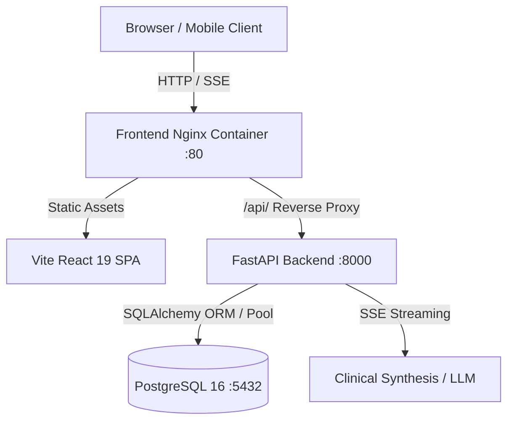

# 🌐 Vigil Health Copilot - Production Deployment Guide

This document outlines the architecture, containerization, database provisioning, and continuous deployment workflows required to run **Vigil** in production environments.

---

## 🏛️ System Architecture



### Core Production Services
1. **Frontend (`frontend/Dockerfile`)**:
   - Multi-stage build (Node.js 22 alpine builder -> Nginx alpine runner).
   - Serves pre-compressed static assets with immutable cache headers.
   - Provides SPA route fallback (`try_files $uri /index.html`).
   - Reverse proxies `/api` to the backend with `proxy_buffering off` for real-time Server-Sent Events (SSE) AI streaming.
   - Includes standard HIPAA/PCI security headers (`X-Frame-Options`, `nosniff`, `X-XSS-Protection`).

2. **Backend (`backend/Dockerfile`)**:
   - Multi-stage Python 3.11-slim container running as a non-root user (`appuser`).
   - High-throughput Uvicorn ASGI workers.
   - Database connection pooling with automatic reconnection (`pool_pre_ping=True`).
   - JWT authentication, PBKDF2-HMAC-SHA256 password security, and CORS policies.
   - Active `/api/health` probe.

3. **Database (`db`)**:
   - PostgreSQL 16 Alpine container with persistent storage volume.
   - Automatic zero-downtime schema provisioning and database seeding on boot.
   - Zero-config fallback to SQLite (`vigil.db`) for lightweight or local environments.

---

## 🚀 1. One-Click Docker Compose Deployment

The simplest way to deploy the complete multi-service stack to any cloud server (AWS EC2, DigitalOcean Droplet, Linode, Hetzner, etc.):

### Step 1: Clone and Configure Environment
```bash
git clone <your-repo-url> vigil
cd vigil

# Copy production environment template
cp .env.example .env
```

Edit `.env` to set your secrets:
```ini
ENVIRONMENT=production
DEBUG=false
POSTGRES_USER=vigil_prod_user
POSTGRES_PASSWORD=your_super_secret_database_password
POSTGRES_DB=vigil_health_db
SECRET_KEY=generate_with_openssl_rand_hex_32
CORS_ORIGINS=https://vigilhealth.yourdomain.com,http://localhost
```

### Step 2: Launch Stack
```bash
# Automated deployment script
./deploy.sh

# Or directly with Docker Compose
docker compose up -d --build
```

### Step 3: Verify Running Services
```bash
docker compose ps
docker compose logs -f backend
```

Your services will now be running:
- **Web App**: `http://<your-server-ip>:80`
- **Backend API**: `http://<your-server-ip>:8000`
- **Swagger Docs**: `http://<your-server-ip>:8000/docs`
- **Health Check**: `http://<your-server-ip>:8000/api/health`

---

## ☁️ 2. Cloud Platform Deployments

### Option A: Railway / Render / Fly.io

1. **Deploy PostgreSQL**:
   - Provision a PostgreSQL database on your platform.
   - Copy the provided `DATABASE_URL`.

2. **Deploy Backend**:
   - Point the service to the `/backend` folder.
   - Set environment variables:
     - `DATABASE_URL`: Your PostgreSQL connection string.
     - `SECRET_KEY`: Random 64-character string.
     - `CORS_ORIGINS`: Your frontend URL.
     - `ENVIRONMENT`: `production`.
   - Build Command: `pip install -r requirements.txt`
   - Start Command: `uvicorn main:app --host 0.0.0.0 --port $PORT --workers 2`
   - Healthcheck Path: `/api/health`

3. **Deploy Frontend**:
   - Point to the `/frontend` folder.
   - Build Command: `npm install && npm run build`
   - Output Directory: `dist`
   - Set API Proxy / Base URL to your deployed backend URL.

---

### Option B: AWS ECS / Fargate

1. Build & Push Docker images to **Amazon ECR**:
```bash
aws ecr get-login-password --region us-east-1 | docker login --username AWS --password-stdin <aws_account_id>.dkr.ecr.us-east-1.amazonaws.com

# Backend
docker build -t vigil-backend ./backend
docker tag vigil-backend:latest <aws_account_id>.dkr.ecr.us-east-1.amazonaws.com/vigil-backend:latest
docker push <aws_account_id>.dkr.ecr.us-east-1.amazonaws.com/vigil-backend:latest

# Frontend
docker build -t vigil-frontend ./frontend
docker tag vigil-frontend:latest <aws_account_id>.dkr.ecr.us-east-1.amazonaws.com/vigil-frontend:latest
docker push <aws_account_id>.dkr.ecr.us-east-1.amazonaws.com/vigil-frontend:latest
```

2. Attach an **Application Load Balancer (ALB)** with HTTPS certificate from **AWS Certificate Manager (ACM)**.
3. Use **Amazon RDS PostgreSQL** (Multi-AZ) for HIPAA-compliant persistent clinical data.

---

## 🔒 3. SSL / TLS Setup with Nginx & Let's Encrypt (Bare Metal / VPS)

If hosting on a bare Linux VM with a custom domain (`health.yourdomain.com`):

1. Install Certbot:
```bash
sudo apt update && sudo apt install -y certbot python3-certbot-nginx
```

2. Issue SSL Certificate:
```bash
sudo certbot --nginx -d health.yourdomain.com
```

Certbot automatically configures TLS 1.3 encryption, automatic renewals, and HTTP -> HTTPS redirects.

---

## 🧪 4. CI/CD & Automated Verification

The repository includes a ready-to-run GitHub Actions pipeline in `.github/workflows/ci.yml`.

Every push runs:
1. **Backend Test Suite (`pytest`)**:
   - Healthcheck & DB ping tests.
   - User registration, password hashing & JWT auth checks.
   - Vitals & 8-day telemetry trends.
   - Medications CRUD & toggle state persistence.
   - Lab reports & out-of-range biomarker flags.
   - SSE chat streaming with real-time token delivery and clinical citations.
2. **Frontend Production Build**:
   - TypeScript compilation (`tsc -b`).
   - Tailwind CSS minification & asset optimization.
3. **Docker Multi-Stage Build**:
   - Validates that production Dockerfiles build cleanly.

To run the tests locally:
```powershell
# Windows
npm run test

# Linux / Mac
pytest backend/test_api.py -v
```

---

## 🗄️ 5. Database Management & Backups

### Automated Database Backup
To backup your PostgreSQL database:
```bash
docker exec -t vigil_db pg_dump -U vigil_user vigil_db > backup_$(date +%Y%m%d).sql
```

### Restore Database
```bash
cat backup_20261011.sql | docker exec -i vigil_db psql -U vigil_user -d vigil_db
```

---

## 🛡️ 6. Security & Compliance Checklist
- [x] Non-root execution in Docker containers.
- [x] Salted PBKDF2-HMAC-SHA256 password hashing.
- [x] Signed JWT access tokens with configurable expiration.
- [x] Strict CORS configuration with granular origins.
- [x] Email OTP 2-Factor Verification to block fake email registrations and unauthorized logins.
- [x] SMTP integration with HTML email templates and brute-force cooldown rate limiting.
- [x] SQL injection protection via SQLAlchemy ORM parameterized queries.
- [x] Nginx security headers (`X-Frame-Options`, `nosniff`, `X-XSS-Protection`).
- [x] SSE streaming without proxy buffering.
- [x] Health check endpoints for automated load-balancer restarts.
